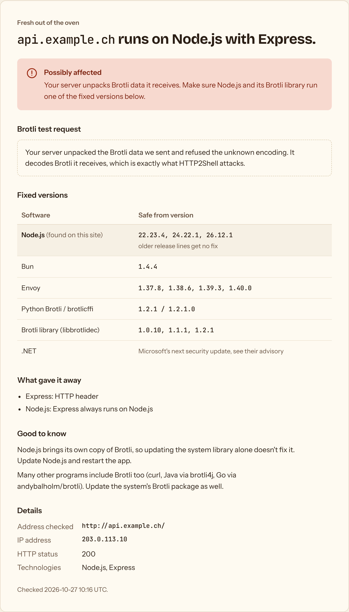

# brotli2scan

Finds web servers affected by **HTTP2Shell** (CVE-2026-111497), the memory
corruption bug in the Brotli decompressor. Part of [shouldipanic.ch](https://shouldipanic.ch).

HTTP2Shell is in the Brotli *decoder*. A server is exposed when it unpacks Brotli
data it receives, for example request bodies sent with `Content-Encoding: br`
(Express 5 / body-parser 2 does this by default). It hits Node.js, Bun, Python
apps using the Brotli or brotlicffi packages, Envoy with the Brotli decompressor,
.NET and everything that links an old `libbrotlidec`. Only compressing outgoing
pages with Brotli is not affected.

brotli2scan comes in two forms:

- **`brotli2scan.py`**: a single Python file with no dependencies for checking
  your own servers: IP ranges, port scan, vhost discovery, platform fingerprinting
  and an optional Brotli test request.
- **A web page** (Docker image) where anyone can check one website, with abuse
  protection. It runs at [brotli2scan.shouldipanic.ch](https://brotli2scan.shouldipanic.ch).



## Command line

```bash
curl -LO https://github.com/akaihigurashi/brotli2scan/releases/latest/download/brotli2scan.py
python3 brotli2scan.py 203.0.113.0/24
```

Python 3.8 or newer, nothing to install. Examples:

```bash
python3 brotli2scan.py 203.0.113.10                     # 20 web ports + every vhost on the IP
python3 brotli2scan.py 203.0.113.10 -b                  # + Brotli test request on every endpoint
python3 brotli2scan.py https://api.example.ch/v1/orders -b   # test one API route
python3 brotli2scan.py 203.0.113.0/24 --names domains.txt    # + hostnames from your own data
python3 brotli2scan.py 203.0.113.10 -p all -o out.csv   # all 65535 ports, CSV output
python3 brotli2scan.py -h                               # all options
```

| Verdict | Meaning |
|---|---|
| `VULNERABLE` | The platform version is visible and older than the fix |
| `PATCHED` | The platform version is visible and includes the fix |
| `DECODES BR` | (`-b`) The server unpacks Brotli request bodies |
| `POSSIBLE` | A platform that includes the Brotli decoder, version hidden |
| `NO SIGN` | Nothing affected visible |

### The Brotli test request (`-b`)

brotli2scan sends two small POST requests to the page: one with a **valid**
Brotli body (the 6 bytes that encode `{}`) and one with an unknown
`Content-Encoding`. A server that refuses the unknown encoding (HTTP 415) but
accepts the Brotli one unpacks Brotli it receives. Only valid, harmless data is
sent, never the malformed data that triggers the bug.

The test works best against an endpoint that reads JSON bodies. A start page that
ignores POST bodies answers both requests the same way, which tells you nothing.
Give an API route as target when you know one.

## Web page with Docker

```bash
docker run -d --name brotli2scan --restart unless-stopped \
  -p 127.0.0.1:8089:8089 \
  -e PANIC_ORIGIN=https://brotli2scan.example.ch \
  -v brotli2scan-data:/data \
  ghcr.io/akaihigurashi/brotli2scan:latest
```

Or with Compose: download [`docker-compose.yml`](docker-compose.yml), set
`PANIC_ORIGIN`, then `docker compose up -d`. The container listens on localhost
only; put a reverse proxy with TLS in front of it
([nginx example](deploy/nginx.conf)).

| Variable | Default | Purpose |
|---|---|---|
| `PANIC_ORIGIN` | – | Public address. Requests from other origins are refused. **Set it.** |
| `PANIC_OPERATOR` / `PANIC_CONTACT` | – | Optional contact section at the bottom of the page |
| `PANIC_IMPRINT_URL` | – | Optional link to an existing imprint |
| `PANIC_TRUSTED_PROXY` | `127.0.0.1,::1` | Proxies whose `X-Real-IP` header is trusted |
| `PANIC_DENY_HOSTS` / `PANIC_DENY_IPS` | – | Never check these domains / addresses |
| `PANIC_AUDIT_DIR` | `/data/audit` | Daily audit log files |
| `PANIC_RETENTION_DAYS` | `30` | Audit files older than this are deleted |

The page has the same protections as [php2scan](https://github.com/akaihigurashi/php2scan#abuse-protection):
consent checkbox, audit log, VPN/Tor/datacenter clients refused, rate limit,
result cache, public hostnames only with the connection pinned to the checked
address, websites that are never checked (well-known services, the 100 most
visited sites, government sites, sanctioned countries), and no access from
sanctioned countries. The Brotli test
request only runs when the visitor ticks it, and it is logged.

## How it's built

The scanner engine (fetching, fingerprinting, port scan, vhost discovery, web
server) lives in [panic-core](https://github.com/akaihigurashi/panic-core).
Everything specific to HTTP2Shell is in [`check.py`](check.py).
`brotli2scan.py` and `web.py` are generated from both:

```bash
git clone https://github.com/akaihigurashi/panic-core ../panic-core
python3 ../panic-core/bundle.py check.py
```

## License

GPL-3.0, see [LICENSE](LICENSE). Fingerprints include data from
[webappanalyzer](https://github.com/enthec/webappanalyzer) (GPL-3.0). Fonts:
Bricolage Grotesque, Instrument Sans and JetBrains Mono (SIL Open Font License).
